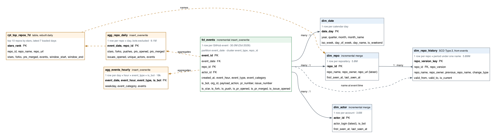

# oss-pulse

A daily batch pipeline that turns [GH Archive](https://www.gharchive.org/) (every public GitHub event, one gzip file per hour) into a tested BigQuery star schema and a public dashboard. It runs on Terraform-managed GCP resources, orchestrated by Airflow 3.

**[Live dashboard](https://datastudio.google.com/reporting/b792d5da-dff2-41cb-b080-cb675a64c5ca)** · [How to run](#how-to-run) · [Cost](#cost) · [Dev log](docs/DEVLOG.md)


## Problem

GitHub shows the activity of one repository at a time. It does not answer cross-repository questions such as "which projects are gaining attention this week?" or "how much of GitHub's activity is automated?". GH Archive has the raw data, millions of events a day as nested JSON, but nobody can query that directly. Teams that track open source (OSS program offices, developer relations, engineers choosing a dependency) need it cleaned, modeled and refreshed every day, with numbers they can trust.

**Business questions** and where each one is answered:

| # | Question | Answered by |
|---|---|---|
| 1 | Which repositories gained the most stars this week? | `rpt_top_repos_7d` → dashboard "Top 10 repos" |
| 2 | What kinds of activity happen on GitHub, and how does the mix change day by day? | `agg_events_hourly` → "Events by type", "Daily events by category" |
| 3 | When are human developers active (hour of day, UTC)? | `agg_events_hourly` → heatmap |
| 4 | How much of the activity is bots? | `is_bot` on `dim_actor` / `fct_events` → "Bot share" (22.9% in Oct 2026) |
| 5 | Is a given day complete and correct? | `oss_pulse_audit.load_log`, dbt tests, [DATA_NOTES](docs/DATA_NOTES.md) |

## Architecture


One Airflow run processes one UTC day, and each step can be re-run safely:

1. **Ingest:** stream 24 hourly files from GH Archive into GCS `raw/`.
2. **Process:** Spark on Dataproc Serverless flattens the JSON into typed Parquet, with quality gates.
3. **Load:** replace that day's partition of `raw.events` in BigQuery.
4. **Transform:** dbt checks freshness, builds staging → intermediate → marts, and tests them.
5. **Audit:** record the run's outcome in `audit.load_log`.

Looker Studio reads two small mart tables. The diagram source is [docs/diagrams/architecture.dot](docs/diagrams/architecture.dot) (`make diagrams`).

## Tech stack

| Layer | Tool | Why this one | Alternative considered |
|---|---|---|---|
| Cloud | **GCP** | BigQuery's free tier (1 TiB queries/month) and serverless Spark cover the whole project for about $2 | AWS (Athena/EMR): similar, more moving parts |
| Infrastructure | **Terraform** | Bucket, datasets, service account, IAM and network are reviewable code; `terraform destroy` removes everything | Clicking in the console: not reproducible |
| Ingestion | **Python** (`requests` + `google-cloud-storage`) | Streams HTTP into a GCS resumable upload with no local disk; small, fully unit-tested | Storage Transfer Service: no per-hour retries, exit codes or logging under my control |
| Processing | **Spark on Dataproc Serverless** | Explicit schema for nested, drifting payloads; quality gates *before* the warehouse; no cluster to manage. 2025 volumes are 3.5M events/day, 1.3B a year | BigQuery `LOAD` of raw JSON + SQL: enough at today's ~100k events/day (see [Limitations](#limitations-and-future-improvements)) |
| Warehouse | **BigQuery** | Serverless; day partitions and clustering make each daily query read megabytes, not gigabytes | Snowflake: no free tier |
| Transformation | **dbt** | Tests that gate downstream models, incremental partition replacement, lineage and docs | Scheduled SQL: no tests or lineage |
| Orchestration | **Airflow 3** (Docker Compose) | Data-interval scheduling, catchup/backfill, retries, deferrable Dataproc operator, failure callbacks | Cloud Composer: managed, but several hundred dollars a month even when idle; Dagster: also good, less common in job ads |
| Dashboard | **Looker Studio** | Free, native BigQuery connector, shareable link | Metabase/Superset: needs hosting |
| CI/CD | **GitHub Actions** + Workload Identity Federation | Every PR: lint (Python, SQL, Terraform), tests, secret scan, DAG import, and a real dbt build on BigQuery, with no stored GCP key | JSON key in GitHub Secrets: long-lived, can leak |

## Data model



A star schema in `oss_pulse_marts`, plus reporting tables built for the dashboard. Diagram source: [docs/diagrams/data_model.dot](docs/diagrams/data_model.dot).

| Table | Grain (one row per …) | Build | Rows (Oct 2026) |
|---|---|---|---|
| `fct_events` | GitHub event | incremental `insert_overwrite`, partitioned by `event_date`, clustered by `event_type, repo_id` | 30.0M |
| `dim_repo` | repository (`repo_id`, stable across renames) | incremental `merge`; latest name, first/last seen | 5.8M |
| `dim_repo_history` | repository × period under one owner/name (**SCD Type 2**) | table, rebuilt daily from `int_repo_name_segments` | 5.89M |
| `dim_actor` | account (`actor_id`) | incremental `merge`; latest login, `is_bot` | 3.6M |
| `dim_date` | calendar day | table (`dbt_utils.date_spine`) | 457 |
| `agg_repo_daily` | repo × day, **bots excluded** | incremental `insert_overwrite` | 9.1M |
| `agg_events_hourly` | day × hour × event type × `is_bot` | incremental `insert_overwrite` | 17.6k |
| `rpt_top_repos_7d` | rank (top 10 repos by stars, latest 7 loaded days) | table, rebuilt daily | 10 |

**Business rules live in one place,** [int_events_enriched](dbt/oss_pulse/models/intermediate/int_events_enriched.sql):
- event category (from a seed);
- the bot flag (macro + seed);
- a star is a `WatchEvent` with action `started`;
- a merged PR counts under both the old and the new payload format.

Every mart counts from these flags. The data's quirks are documented in [DATA_NOTES](docs/DATA_NOTES.md).

**Repository history (SCD2).** Repos get renamed and transferred much more often than I expected: **42,422 repos (0.7%) in October alone**, one of them 11 times. [dim_repo_history](dbt/oss_pulse/models/marts/dim_repo_history.sql) keeps every period with `valid_from` / `valid_to` / `is_current` and a `change_type` (`renamed` 31k, `transferred` 10.5k, both 2.5k). In the sample I joined, **1.4% of events happened under a name the repo no longer has**, and the point-in-time join shows them under the right one:

```sql
join dim_repo_history h on h.repo_id = e.repo_id
 and e.created_at >= h.valid_from and (e.created_at < h.valid_to or h.valid_to is null)
```

- **Built from events, not with `dbt snapshot`.** A snapshot only records what it sees when it runs. A backfill of October would have produced one row per repo, and lost history could never be rebuilt. Here, every rebuild reproduces the same history, and re-running a day leaves it byte-for-byte identical.
- **Gaps and islands, not `group by name`.** 233 repos were renamed *back* (e.g. `homelab` → `homeprod` → `homelab`). Grouping by name would merge the two `homelab` periods into one that overlaps `homeprod`.
- **Exact order.** [int_repo_name_segments](dbt/oss_pulse/models/intermediate/int_repo_name_segments.sql) compacts each day to runs of one name, ordered by `created_at` and then `event_id`, so ties within a second are deterministic. `dim_repo` uses the same tie-break.
- **Tested:** exactly one current row per repo, periods that chain with no gap or overlap, the current name equal to `dim_repo`, and two unit tests (rename back, midnight continuation, same-second ties).

## Pipeline

### Infrastructure (Terraform)

Everything in GCP is defined in [terraform/](terraform/) except the state bucket.

| Resource | Purpose |
|---|---|
| `google_project_service.apis` | Enables Storage, BigQuery, Dataproc, Compute and IAM APIs |
| `google_storage_bucket.lake` | Data lake. Uniform bucket-level access, public access blocked, objects under `raw/` deleted after 90 days. `force_destroy` only when `environment = "dev"` |
| `google_bigquery_dataset.this[…]` | `oss_pulse_raw`, `oss_pulse_staging`, `oss_pulse_marts`, `oss_pulse_audit` |
| `google_service_account.pipeline` | `oss-pulse-pipeline`, the identity Dataproc runs as |
| IAM | `storage.objectAdmin` on the **lake bucket only**, `bigquery.dataEditor` on the **4 datasets only**, `bigquery.jobUser` and `dataproc.worker` on the project (they can't be granted more narrowly) |
| VPC + subnet + firewall | `oss-pulse-subnet` for Dataproc: Private Google Access, no public IPs |

**Decision: Terraform creates the datasets, and dbt only writes into them.**
- Why: access is granted per dataset, not project-wide; every dataset gets the same location and labels; and `terraform destroy` removes everything.
- Trade-off: a new dbt layer needs a Terraform change first.
- [generate_schema_name](dbt/oss_pulse/macros/generate_schema_name.sql) sends `prod` models to these datasets. `dev` and `ci` write to their own dataset, so they can never overwrite real tables.

**Why remote state.** Terraform's state file is its record of which real resources it manages. Kept on a laptop, it can be lost, and Terraform then tries to recreate resources that already exist. It can also diverge between machines. A separate, versioned GCS bucket gives:
- one source of truth;
- locking;
- version history;
- no state file in git.

`make tf-bootstrap` creates that bucket outside the configuration, so `terraform destroy` can't delete the state that tracks it.

### Ingestion (GH Archive → GCS raw)

[ingestion/gharchive.py](ingestion/gharchive.py) streams each hourly file over HTTP **directly into GCS**, without writing to local disk:

```
https://data.gharchive.org/2026-10-01-15.json.gz
  → gs://$GCS_BUCKET/raw/gharchive/dt=2026-10-01/hr=15/2026-10-01-15.json.gz
```

| Behavior | Detail |
|---|---|
| Retries | Up to 3 attempts per hour (`INGEST_MAX_ATTEMPTS`), exponential backoff with jitter, on network errors, HTTP 5xx/429 and GCS 5xx/429. Other 4xx errors fail immediately |
| 404 | Recorded as `missing` (not published yet, or a known gap); the other hours still run |
| Idempotent | Same object path every run. An hour is **skipped** if the object already exists with the same size; `--force` overwrites |
| No partial files | The upload only becomes an object when the stream completes; a size mismatch against `Content-Length` deletes it and retries |
| Logging | One JSON line per hour (`hour`, `status`, `bytes`, `duration_s`, `attempts`) plus a `run_summary`, e.g. `24/24 ok` |
| Exit codes | `0` ok · `1` an hour failed · `2` usage/config error · `3` only missing hours (`--allow-missing` → 0) |

### Processing (Spark → processed/events)

[spark/flatten_events.py](spark/flatten_events.py) turns one day of raw JSON into typed Parquet (`processed/events/dt=<day>/`):

| Behavior | Detail |
|---|---|
| Schema | Explicit `StructType`, no inference. The raw payload is kept as `payload_json` |
| Time zone | Session time zone fixed to UTC. A test runs the JVM in America/Los_Angeles to prove dates don't shift |
| Cleaning | Drops corrupt JSON, rows missing id/type/timestamp, and rows outside `--date`; de-duplicates on `event_id` |
| Quality gate | Exits 1 **without writing** if there's no input, no valid rows, more than 1% bad rows, or more than 1% rows outside the date |
| Idempotent | Overwrites exactly `dt=<date>/` and writes `_SUCCESS` |
| Runtime | Dataproc Serverless 2.2 (Spark 3.5), driver + 2 executors, as the `oss-pulse-pipeline` service account in `oss-pulse-subnet`. Tested locally on Spark 4 |

### Warehouse (BigQuery) and the partitioning decision

[warehouse/ddl/events.sql](warehouse/ddl/events.sql) defines `oss_pulse_raw.events`:
- **partitioned by `DATE(created_at)`**;
- **clustered by `event_type, repo_name`**;
- `require_partition_filter = TRUE`.

The load job replaces exactly one partition (`events$YYYYMMDD`, `WRITE_TRUNCATE`), and only after Spark's `_SUCCESS` marker exists.

**Why partition by day.** Every question here is bounded in time: daily builds, "stars this week". A day query reads one partition instead of all history, and the daily load can replace one partition atomically, which makes re-runs idempotent. `require_partition_filter` turns this into a guardrail: a query without a date filter is rejected rather than scanning every day.

**Why cluster by `event_type` first.** Almost every metric starts from one event type (stars = `WatchEvent`), and the types are very skewed: `WatchEvent` was 0.64% of rows and `PushEvent` 73.9%. Clustering lets BigQuery skip almost every block for such queries. `repo_name` comes second, for repo drill-downs.

**Measured** (top 10 starred repos on 2026-10-02, 3 days loaded, cache off; [cost_demo.sh](warehouse/cost_demo.sh), [results](docs/bq_cost_results.json)):


| Query | Bytes processed | Bytes billed |
|---|---|---|
| A: unpartitioned copy, no filter | 168.5 MB | 168.8 MB |
| B: unpartitioned copy, **same SQL as C** | 290.7 MB | 291.5 MB |
| C: `raw.events`, partitioned + clustered | **0.9 MB** (−99.7% vs B) | 10.5 MB (BigQuery's 10 MB minimum) |

- On an unpartitioned table, filters make a query *more* expensive (B > A), because BigQuery must also read the filter columns and can't skip anything.
- When the filter value came from a subquery, block pruning stopped working: 97.7 MB, about 109× more. So filter clustered columns with constants or parameters. The dbt macros follow that rule.

### Transformation (dbt)

[dbt/oss_pulse/](dbt/oss_pulse/): staging view → intermediate view (business rules) → marts ([lineage](docs/dbt_lineage.png)).

- **Incremental by partition.** One macro, [event_window](dbt/oss_pulse/macros/event_window.sql), decides which days a run rebuilds: `run_date` and the day before, or all history on a first build. Its bounds are constants, so BigQuery prunes partitions. Fact and aggregate tables swap partitions with **copy jobs** (`copy_partitions: true`), which cut a 2-day run from 987 MB to 333 MB processed. Re-running a day replaces it, so runs are idempotent.
- **Environments.** `dev` → your own dataset (`DBT_DEV_DATASET`). `prod` → the Terraform datasets. `ci` → `oss_pulse_ci`. [profiles.yml](dbt/oss_pulse/profiles.yml) is committed: every value comes from `env_var()`, auth is ADC, and each query is capped at 10 GB billed.
- **Bots.** [is_bot](dbt/oss_pulse/macros/is_bot.sql) flags logins ending in `[bot]` plus a seed of service accounts that don't, such as `copilot` (16k events across 6.5k repos in three days).

### Orchestration (Airflow 3)

[oss_pulse_daily.py](airflow/dags/oss_pulse_daily.py) runs one UTC day per run:

```
ingest_raw → spark_flatten → load_bq_partition → dbt_source_freshness → dbt_build → publish_dbt_manifest → record_audit
```

| Task | How it runs | Why it is safe to re-run |
|---|---|---|
| `ingest_raw` | `BashOperator` → `python -m ingestion.gharchive --date {{ ds }}` | Skips hours already in GCS with the same size |
| `spark_flatten` | `DataprocCreateBatchOperator` (deferrable) runs the uploaded job | Overwrites `dt=<ds>/`; new batch ID per attempt |
| `load_bq_partition` | Checks `_SUCCESS`, then a load job into `raw.events$<ds_nodash>` | `WRITE_TRUNCATE` on one partition is atomic |
| `dbt_source_freshness` | Only when the day ended < 2 days ago (backfills skip it) | Read-only |
| `dbt_build` | `dbt build --target prod --vars '{run_date: <ds>}'` | `insert_overwrite` and `merge` |
| `publish_dbt_manifest` | Uploads the build's `manifest.json` to `gs://<bucket>/dbt/prod/`: Slim CI's baseline | Overwrites one object |
| `record_audit` | `trigger_rule=all_done` → `oss_pulse_audit.load_log` | Append-only: one row per attempt |

**Design decisions.**
- **Interval scheduling.** `CronDataIntervalTimetable("@daily")`: the run for day D starts after D+1 00:00 UTC, once the day is complete. In Airflow 3, plain `"@daily"` would start at D 00:00, before any of D's data exists.
- **Dates and retries.** Dates come only from `{{ ds }}`. Retries back off 5 → 10 → 20 min, and every task has a timeout.
- **One dbt build at a time** (`max_active_tis_per_dag=1`). Two days can ingest and load in parallel, but dbt builds don't collide. `depends_on_past` was tried first and **deadlocked** when an old day was re-run ([DEVLOG](docs/DEVLOG.md)).
- **One Spark batch at a time.** A batch needs 12 vCPUs, and the project quota is 16. `spark_flatten` retries every 2 min because Dataproc releases vCPUs a little after a batch reports success.
- **The audit records failures too.** `record_audit` runs after a failure, writes `status=failed`, then fails itself, so a failed pipeline can't show a green run.
- **Alerts.** [alerts.py](airflow/dags/oss_pulse_lib/alerts.py) posts to a Slack webhook from the Airflow Variable `slack_webhook_secret` (`AIRFLOW_VAR_SLACK_WEBHOOK_SECRET` in `.env`). One alert per failed task, after the last retry.
- **Credentials.** Your ADC file is mounted read-only from outside the repo. It is never in the DAG, the image or git.
- **Docker.** [docker-compose.yaml](airflow/docker-compose.yaml) is the official Airflow 3.4.0 file, with every change marked `oss-pulse:`. [Dockerfile](airflow/Dockerfile) adds the ingestion dependencies, plus dbt in its own venv. Code is mounted, not baked in. The UI listens on `127.0.0.1` only.

**October 2026 backfill (catchup, 31 runs):**

| Check | Result |
|---|---|
| Runs | **31/31 success** |
| Rows | **30,008,428** in `raw.events` = `fct_events`; audit `rows_loaded` matches on all 31 days; 0 duplicate `event_id`s |
| Audit trail | 34 rows: one `success` per day, 2 earlier `failed` attempts (laptop sleep, see DEVLOG), and the chaos test's second `success` |
| Chaos test (10-15) | Cleared and re-run in 4 min: every count identical before and after |
| Failure alert | Smoke-tested end to end in Airflow 3.4 |

## Data quality

Checks at every layer. A failure stops the run before bad data reaches the next layer.

| Layer | Check | On failure |
|---|---|---|
| Ingestion | HTTP status, `Content-Length` vs uploaded size, 24 hours present | Retry; exit 1 (or 3 for missing hours) fails the task |
| Spark | Explicit schema; ≤ 1% corrupt/invalid rows; ≤ 1% rows outside the date; de-duplication on `event_id` | Exit 1, **nothing written** |
| Load | `_SUCCESS` must exist; 0 rows loaded = error; BigQuery rejects rows from another date | Task fails; partition unchanged |
| dbt sources | **Freshness**: `max(created_at)` warn > 26 h, error > 50 h | Run fails before building |
| dbt models | **66 tests**: `unique` + `not_null` on every key; `unique_combination_of_columns` on the aggregates; `relationships` from `fct_events` to all 3 dims; SCD2 rules for `dim_repo_history` (one current row, periods chain, agrees with `dim_repo`); `accepted_values` for the 16 event types and 24 hours; [assert_no_negative_counts](dbt/oss_pulse/tests/assert_no_negative_counts.sql); **3 unit tests**: `is_bot` (`dependabot[bot]`, `COPILOT` → bot; `abbot`, `octocat` → human) and the SCD2 period logic | A failing test **skips every downstream model** |
| Run | `audit.load_log`: status, rows loaded, failed tasks, run id | Failed runs are recorded and alerted |
| Idempotency | `make chaos-test DAY=…` clears a finished day, re-runs it, compares 5 counts | Exit 1 if anything changed |

**Broken on purpose.** I inserted a duplicate event into `fct_events`. The `unique` test failed, `dbt build` exited non-zero, and `agg_repo_daily` (what the dashboard reads) was **skipped**, so it kept the previous correct numbers. Re-running the day replaced the partition and removed the duplicate, with no manual `DELETE` ([write-up](docs/DEVLOG.md)).

**What the tests did *not* catch.** GH Archive stopped publishing push/create/delete events on several October days. Every test passed, because the data was valid, just incomplete. It was found by looking at the backfill ([DATA_NOTES](docs/DATA_NOTES.md#volume)). See the volume check under [future improvements](#limitations-and-future-improvements).

## Dashboard

**[Looker Studio report](https://datastudio.google.com/reporting/b792d5da-dff2-41cb-b080-cb675a64c5ca)** (view-only, no sign-in). Screenshot at the top of this page.

- **Tiles:** events by type, daily events by category, top 10 repos by stars over the latest week, and an hour × weekday heatmap of human activity.
- **Also:** a date-range control and a "how to read" note on the October source gap.

It reads only `agg_events_hourly` (1 MB) and `rpt_top_repos_7d` (10 rows), never `raw` and never the big marts. Each chart refresh is a billed query: on `fct_events` the same tiles would scan ~1 GB, and here each stays at the 10 MB minimum. Build spec: [docs/DASHBOARD.md](docs/DASHBOARD.md).

## CI/CD

Every pull request runs [.github/workflows/ci.yml](.github/workflows/ci.yml). `main` is protected: a PR can only merge when all checks pass, and all work goes through feature branches.

| Check (job) | What it catches | Credentials |
|---|---|---|
| `python (ruff + pytest)` | Lint, formatting, 88 unit tests (ingestion, Spark on a local JVM, alerts); builds the ingestion image | none |
| `sql lint (sqlfluff)` | Style and ambiguity in dbt SQL, as inline PR annotations | none |
| `terraform (fmt + validate)` | Unformatted or invalid Terraform | none |
| `secret scan (gitleaks)` | Keys and tokens anywhere in the git history (pinned release, checksum verified) | none |
| `airflow (DAG import)` | DAG import errors inside the real Airflow image | none |
| `dbt (build on BigQuery)` | SQL that compiles but fails or breaks a test on real data. Builds 2026-10-30..31 in `oss_pulse_ci`, then re-runs the **daily incremental path** on top. Pull requests use **Slim CI** (below); pushes to `main` build everything | Workload Identity Federation |

**No GCP key in GitHub.** The dbt job asks GitHub for a short-lived OIDC token, and [google-github-actions/auth](https://github.com/google-github-actions/auth) exchanges it for a ~1-hour credential of the `oss-pulse-ci` service account ([terraform/ci.tf](terraform/ci.tf)):
- The identity pool only accepts tokens whose `repository` is this repo. Pull requests from forks get no token, and the dbt build is skipped for them.
- The service account can run BigQuery jobs, read `oss_pulse_raw` and write `oss_pulse_ci`. Nothing else: no access to the marts, the bucket or Dataproc.
- `oss_pulse_ci` tables expire after a day. Runs share the dataset, so they're serialized (`concurrency`), and each starts with `--full-refresh`, so results never depend on a previous run.
- A full CI run bills ~0.9 GiB of BigQuery (126 queries, mostly the 10 MB minimum each), so the free tier covers ~1,100 runs a month. A 2 GB per-query cap in the `ci` profile fails the build if the window ever breaks.

**Slim CI on pull requests.** After every successful prod build, Airflow publishes dbt's `manifest.json` (`publish_dbt_manifest`). A PR's CI downloads it, lists the changed models with `dbt ls --select state:modified+`, and builds those with `--defer --favor-state --indirect-selection cautious`:
- **Only the changed models and everything downstream are built.** Editing `agg_repo_daily` builds 14 nodes instead of 56, in 65 s instead of 123 s. A PR that doesn't touch dbt builds nothing.
- **A test runs only if all its parents were built in CI** (`cautious`). Otherwise, changing `dim_repo` would run the relationships test from prod `fct_events` (all history) to a 2-day CI `dim_repo`: 26M false failures. dbt flags every test of a changed model as modified, so the model list must come from `dbt ls` first. The full build on `main` still runs those cross-environment tests.
- **Unchanged parents are read from prod** (`--defer`), read-only, so a PR is tested against real upstream tables.
- **`--favor-state` matters:** without it, dbt prefers a table that already exists in `oss_pulse_ci`. A previous run, possibly from another branch, may have left one there.
- **No manifest yet** (new project): CI falls back to the full build.
- **Least privilege:** the CI service account can read only `gs://<bucket>/dbt/prod/`, via an IAM condition. Its prod access is read-only (`dataViewer` on staging and marts).

**Run the same checks locally:**
```bash
make ci-local      # ruff, sqlfluff, pytest, terraform fmt/validate, gitleaks (no cloud access)
make dbt-ci        # the two full CI dbt builds, with your own credentials
make dbt-ci-slim   # what a pull request runs: only what changed vs. prod
make dbt-publish-manifest   # set Slim CI's baseline from this checkout (Airflow does it daily)
```

**Set it up on your fork** (once, after `make infra-up` with `GITHUB_REPOSITORY=<owner>/<repo>` in `.env`):
```bash
gh variable set GCP_PROJECT_ID         --body "<your-project-id>"
gh variable set GCP_REGION             --body "<your-region>"
gh variable set GCP_WIF_PROVIDER       --body "$(terraform -chdir=terraform output -raw ci_workload_identity_provider)"
gh variable set GCP_CI_SERVICE_ACCOUNT --body "$(terraform -chdir=terraform output -raw ci_service_account_email)"
gh variable set GCS_BUCKET             --body "<your-bucket>"     # Slim CI reads the prod manifest here
```
Then, in **Settings → Branches**, protect `main`: require a pull request, and require the six checks above to pass. These are repository *variables*, not secrets. None of them grants access on its own; access comes from the identity pool's repository condition.

## How to run

### Prerequisites

| Tool | Version | Used for |
|---|---|---|
| A GCP project with billing enabled | You are Owner (Terraform grants IAM; Dataproc needs `iam.serviceAccountUser`); vCPU quota `CPUS_ALL_REGIONS` ≥ 12 | Everything in the cloud |
| [gcloud CLI](https://cloud.google.com/sdk/docs/install) | any recent | Auth, state bucket, Spark upload |
| [Terraform](https://developer.hashicorp.com/terraform/install) | ≥ 1.5 | Infrastructure |
| Docker Desktop (Compose v2) | ≥ 4 GB RAM for Docker | Airflow |
| Python | ≥ 3.11 | Ingestion, dbt, tests |
| Java | 17 | Spark tests and `spark-local` only |
| make, git | | |

### Steps

```bash
# 1. Get the code and the Python environment
git clone https://github.com/trinhtran-it/oss-pulse.git && cd oss-pulse
make setup                      # .venv with all deps + dbt packages
make test lint                  # 88 tests, no cloud access needed

# 2. Configure: .env is the only file to edit
cp .env.example .env
#    GCP_PROJECT_ID, GCP_REGION, GCS_BUCKET (globally unique), TF_STATE_BUCKET (globally unique),
#    DBT_DEV_DATASET, and FERNET_KEY from:
.venv/bin/python -c 'from cryptography.fernet import Fernet; print(Fernet.generate_key().decode())'

# 3. Log in (user + Application Default Credentials, used by Terraform, dbt and Airflow)
gcloud auth login
gcloud auth application-default login
gcloud config set project <your-project-id>

# 4. Create the cloud resources (shows the plan and asks before applying)
make infra-up                   # state bucket, Terraform, BigQuery tables, Spark job upload

# 5. Run the pipeline in Airflow
make airflow-build up           # UI: http://localhost:8080 (airflow / airflow)
make airflow-unpause            # catchup: one run per day from OSS_PULSE_START_DATE
```

**How many days run.** Unpausing creates one run per day from `OSS_PULSE_START_DATE` (default 2026-10-01) to `OSS_PULSE_END_DATE` (unset = until yesterday, then daily).
- **Quick demo:** set both to `2026-10-31` in `.env`. One day runs end to end in about 15 minutes for a few cents.
- **Full October:** `2026-10-01` → `2026-10-31`. About 30M events and ~$1 of Dataproc. Several hours, because Spark runs one day at a time under the default quota.

Watch the runs in the UI. Each finished day adds a row to `oss_pulse_audit.load_log`.

```bash
# 6. Other useful commands (`make help` lists them all)
make ingest DATE=2026-10-31                       # one pipeline step by hand
make dbt-build RUN_DATE=2026-10-31                # dbt into your dev dataset (the first build reads
                                                  #   every loaded day: ~7 GB per model for October)
make backfill START=2026-10-01 END=2026-10-03     # re-run failed or missing days
make chaos-test DAY=2026-10-15                    # prove a re-run changes nothing

# 7. Clean up
make down                       # stop Airflow
make infra-down                 # delete bucket, datasets and IAM (asks first; dev only deletes data)
```

**Dashboard.** Connect Looker Studio to the two tables as described in [docs/DASHBOARD.md](docs/DASHBOARD.md). It's about 30 minutes of clicking, because Looker Studio has no config-as-code.

## Cost

What this project actually used from 2026-11-01 to 11-19. That covers every development run plus the October backfill, measured from `INFORMATION_SCHEMA.JOBS`, Dataproc batch usage and storage sizes. Prices are list prices, US regions.

| Service | Measured usage | Price | Cost |
|---|---|---|---|
| Dataproc Serverless | 10.56 DCU-hours, 1,069 GiB-hours shuffle storage (61 batches; 23 quota-rejected ones never started) | $0.060 / DCU-hour, $0.000055 / GiB-hour | **≈ $0.70** |
| BigQuery queries | 129 GiB billed in 2,788 jobs | first 1 TiB / month free | **$0** |
| BigQuery loads + copies | 45.8 GiB loaded, 170 partition copies | free | **$0** |
| BigQuery storage | 36.4 GiB (raw 32.7, marts 3.7) | first 10 GiB free, then ≈ $0.02 / GiB-month | **≈ $0.55 / month** |
| Cloud Storage | 17.8 GiB (raw 7.4, Parquet 10.5) | ≈ $0.02 / GiB-month | **≈ $0.36 / month** |
| Airflow | local Docker | — | **$0** |
| **Total** | | | **≈ $0.70 one-off + ≈ $0.90 / month storage, under $2 for the month** |

- **Steady state, one new day per day:** about 0.3 DCU-hours ($0.02) and ~4 GiB of queries per day, so about $1/month plus storage growth.
- **Biggest cost levers:**
  - Partitioning + clustering: −99.7% bytes on the benchmark query.
  - `copy_partitions`: −66% on incremental builds.
  - The dashboard reading 1 MB tables instead of `fct_events`.
  - The 90-day lifecycle rule on `raw/`.
- **Regional prices:** in asia-southeast1 (where this ran) they are somewhat higher. The GCP Billing report for the project is the final number.

## Limitations and future improvements

| Limitation | Impact | Improvement | Effort / cost |
|---|---|---|---|
| **No volume check.** Valid but incomplete days pass every test | The October push/create/delete gap was found by eye | dbt test per event type: warn when a type that existed yesterday is 0, or the day is < 20% of the trailing 7-day median | ~2 h, free |
| **Airflow runs on a laptop** | Sleep caused heartbeat failures and false alerts during the backfill | Cloud Composer 3 (managed), or a small VM running this same Compose file | Composer: several hundred $/month; e2-standard-2 VM: ~$50/month |
| **Tests scan full history** (`unique` on 30M `event_id`s) | Test cost grows every day | `where:` limited to the rebuilt days, plus a weekly full run | ~1 h, free |
| **Bot detection by login name only** | Automation on personal-looking accounts counts as human | Behavioral rules: events/hour, repos touched per hour | ~1 day |
| **One month of data** | Weekday patterns aren't reliable (4–5 samples each); push metrics are incomplete for Oct 2026 | Backfill several months, and show source eras on the dashboard | Dataproc ~$1 per month of data |
| **Spark is more than today's volume needs** | ~100k events/day now; Spark was sized for 2025 volumes (3.5M/day) | Load raw JSON straight into BigQuery and flatten in dbt; keep Spark for large backfills | ~1 day |
| **"Marts only" for the dashboard is a convention** | The dashboard credential (my account) could read `raw` | Service account with `dataViewer` on `oss_pulse_marts` only | ~30 min of Terraform, free |
| **CI builds a fixed 2-day window** (Oct 30–31) | A bug that only shows on other days' data passes CI | Pick the latest loaded days via `INFORMATION_SCHEMA.PARTITIONS`, or add a weekly wider build | ~1 h, ~free |
| **No CD for infrastructure or the Spark job** | `terraform apply` and `make spark-upload` are run by hand after merging | A `main`-only job: `terraform plan` on PRs, `apply` + `spark-upload` after merge, with its own narrowly-scoped service account | ~half a day, free |
| **Spark runs one day at a time** | A month's backfill takes hours | Raise the `CPUS_ALL_REGIONS` quota to 24+ | free (quota request) |

## Repository layout

```
terraform/            GCP resources (bucket, datasets, service account, IAM, network)
ingestion/            GH Archive → GCS (gharchive.py, Dockerfile, tests)
spark/                raw JSON → Parquet (flatten_events.py, tests)
warehouse/            raw.events and load_log DDL, load script, cost benchmark
dbt/oss_pulse/        staging → intermediate → marts, seeds, macros, tests
airflow/              DAG, alert callback, Compose file, image, chaos test
docs/                 DATA_NOTES, DEVLOG, DASHBOARD, diagrams and screenshots
.github/              CI workflow, Dependabot, PR template
```
