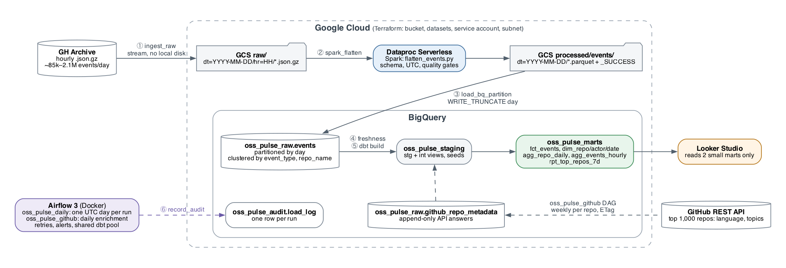
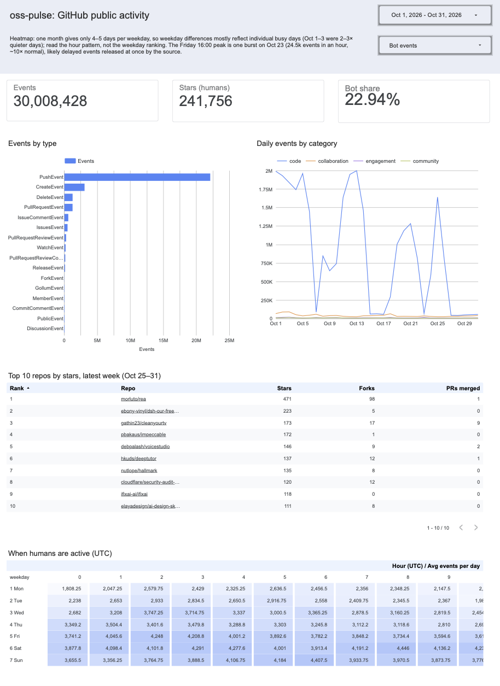

# oss-pulse

Daily analytics on open-source activity from [GH Archive](https://www.gharchive.org/).

## Problem
_TODO: what question does this answer, and for whom?_

## Architecture


```
GH Archive (hourly .json.gz)
  → ingestion/gharchive.py  → GCS (raw)
  → spark/flatten_events.py → GCS (parquet) → BigQuery (raw)
  → dbt (staging → intermediate → marts)
  → dashboard
Orchestrated by Airflow (airflow/dags/oss_pulse_daily.py); infra via Terraform.
```

## Infrastructure (Terraform)

Everything in GCP is defined in [terraform/](terraform/) except the state bucket.

| Resource | Purpose |
|---|---|
| `google_storage_bucket.lake` | Data lake. Uniform bucket-level access, public access blocked, objects under `raw/` deleted after 90 days. `force_destroy` is enabled only when `environment = "dev"` |
| `google_bigquery_dataset.this["raw"\|"staging"\|"marts"]` | `oss_pulse_raw` (loaded from GCS), `oss_pulse_staging` (dbt staging models and seeds), `oss_pulse_marts` (dbt marts) |
| `google_service_account.pipeline` | `oss-pulse-pipeline`, the identity that runs ingestion, Spark, loads and dbt |
| IAM | `storage.objectAdmin` on the **lake bucket only**, `bigquery.dataEditor` on the **3 datasets only**, and `bigquery.jobUser` on the project (it can't be granted more narrowly) |

**Decision: Terraform creates the datasets, and dbt only writes into them.**
- Why: access can be granted per dataset instead of project-wide, every dataset gets the same location and labels, and `terraform destroy` removes everything.
- Trade-off: a new dbt layer needs a Terraform change first.
- `macros/generate_schema_name.sql` sends `dev` and `prod` models to `oss_pulse_staging` and `oss_pulse_marts`. Every other target (e.g. `ci`) writes to its own dataset, so CI can never overwrite real tables.

**Why remote state:** Terraform's state file is its record of which real resources it manages. Kept on a laptop, it can be lost (Terraform then tries to recreate resources that already exist) or diverge between machines and CI. Storing it in a separate, versioned GCS bucket gives:
- one shared source of truth
- locking, so two `apply` runs can't corrupt it
- version history to roll back a bad state
- no state file in git (it can contain sensitive values)

The state bucket is created once by hand, outside this configuration, so that `terraform destroy` can't delete the state that tracks it.

```bash
gcloud auth application-default login
# .env: set GCP_PROJECT_ID, GCP_REGION, TF_STATE_BUCKET
cp terraform/terraform.tfvars.example terraform/terraform.tfvars   # edit
cp terraform/backend.hcl.example     terraform/backend.hcl         # edit
make tf-bootstrap   # once: creates the versioned state bucket
make tf-init
make tf-plan        # review
make tf-apply
make tf-output      # bucket URL, dataset IDs, service account email
```

## How to run
```bash
cp .env.example .env   # fill in values
make setup             # install deps
make up                # start Airflow locally
make backfill START=2026-01-01 END=2026-01-07
make test lint
make down
```

## Results


## Cost


_TODO: BigQuery bytes scanned before/after partitioning + clustering._
