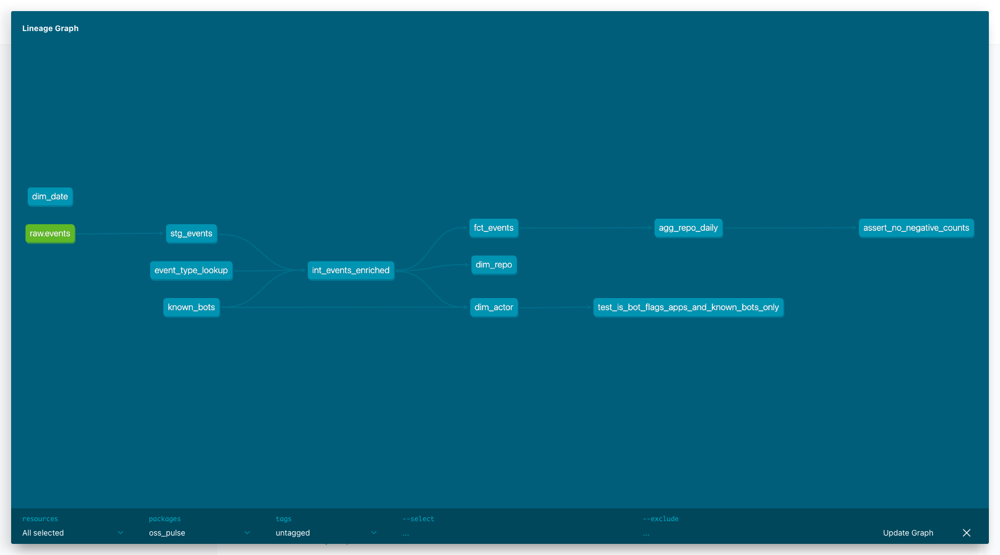

# oss-pulse

Daily analytics on open-source activity from [GH Archive](https://www.gharchive.org/).

## Problem
_TODO: what question does this answer, and for whom?_

## Architecture


```
GH Archive (hourly .json.gz)
  → ingestion/gharchive.py  → GCS (raw)
  → spark/flatten_events.py → GCS (parquet) → BigQuery (raw)
  → dbt (staging → intermediate → marts)
  → dashboard
Orchestrated by Airflow (airflow/dags/oss_pulse_daily.py); infra via Terraform.
```

## Infrastructure (Terraform)

Everything in GCP is defined in [terraform/](terraform/) except the state bucket.

| Resource | Purpose |
|---|---|
| `google_storage_bucket.lake` | Data lake. Uniform bucket-level access, public access blocked, objects under `raw/` deleted after 90 days. `force_destroy` is enabled only when `environment = "dev"` |
| `google_bigquery_dataset.this["raw"\|"staging"\|"marts"]` | `oss_pulse_raw` (loaded from GCS), `oss_pulse_staging` (dbt staging models and seeds), `oss_pulse_marts` (dbt marts) |
| `google_service_account.pipeline` | `oss-pulse-pipeline`, the identity that runs ingestion, Spark, loads and dbt |
| IAM | `storage.objectAdmin` on the **lake bucket only**, `bigquery.dataEditor` on the **3 datasets only**, and `bigquery.jobUser` on the project (it can't be granted more narrowly) |

**Decision: Terraform creates the datasets, and dbt only writes into them.**
- Why: access can be granted per dataset instead of project-wide, every dataset gets the same location and labels, and `terraform destroy` removes everything.
- Trade-off: a new dbt layer needs a Terraform change first.
- `macros/generate_schema_name.sql` sends `dev` and `prod` models to `oss_pulse_staging` and `oss_pulse_marts`. Every other target (e.g. `ci`) writes to its own dataset, so CI can never overwrite real tables.

**Why remote state:** Terraform's state file is its record of which real resources it manages. Kept on a laptop, it can be lost (Terraform then tries to recreate resources that already exist) or diverge between machines and CI. Storing it in a separate, versioned GCS bucket gives:
- one shared source of truth
- locking, so two `apply` runs can't corrupt it
- version history to roll back a bad state
- no state file in git (it can contain sensitive values)

The state bucket is created once by hand, outside this configuration, so that `terraform destroy` can't delete the state that tracks it.

```bash
gcloud auth application-default login
# .env: set GCP_PROJECT_ID, GCP_REGION, TF_STATE_BUCKET
cp terraform/terraform.tfvars.example terraform/terraform.tfvars   # edit
cp terraform/backend.hcl.example     terraform/backend.hcl         # edit
make tf-bootstrap   # once: creates the versioned state bucket
make tf-init
make tf-plan        # review
make tf-apply
make tf-output      # bucket URL, dataset IDs, service account email
```

## Ingestion (GH Archive → GCS raw)

[ingestion/gharchive.py](ingestion/gharchive.py) streams each hourly file over HTTP **directly into GCS**, without writing to local disk:

```
https://data.gharchive.org/2026-10-01-15.json.gz
  → gs://$GCS_BUCKET/raw/gharchive/dt=2026-10-01/hr=15/2026-10-01-15.json.gz
```

```bash
make ingest DATE=2026-10-01                 # all 24 hours
make ingest DATE=2026-10-01 HOURS=0-5,12    # selected hours
make ingest DATE=2026-10-01 ARGS=--force    # re-upload even if unchanged
make ingest-docker DATE=2026-10-01          # same, in the container (mounts your ADC login read-only)
```

| Behavior | Detail |
|---|---|
| Retries | Up to 3 attempts per hour (`INGEST_MAX_ATTEMPTS`), exponential backoff with jitter, on network errors, HTTP 5xx/429 and GCS 5xx/429. Other 4xx errors fail immediately |
| 404 | Recorded as `missing` (not published yet, or a known gap); the other hours still run |
| Idempotent | Same object path on every run. An hour is **skipped** if the object already exists with the same size; `--force` overwrites |
| No partial files | The upload only becomes an object when the stream completes. A size mismatch against `Content-Length` deletes the object and retries |
| Logging | One JSON line per hour (`hour`, `status`, `bytes`, `duration_s`, `attempts`), plus a `run_summary` line, e.g. `24/24 ok` or `22/24 ok; missing hours [3, 4]` |
| Exit codes | `0` ok · `1` an hour failed · `2` usage/config error · `3` only missing hours (`--allow-missing` → 0). Any non-zero code fails the Airflow task, so it retries |
| Config | Environment variables only: `GCS_BUCKET` (required), `GCS_RAW_PREFIX`, `GHARCHIVE_BASE_URL`, `INGEST_MAX_ATTEMPTS`, `GCP_PROJECT_ID` |

Tests (`make test`) cover the pure functions and use a fake HTTP session and bucket for retries, skipping and exit codes. They need no network or credentials.

## Processing (Spark → processed/events)

[spark/flatten_events.py](spark/flatten_events.py) turns one day of raw JSON into typed Parquet:

```
gs://$GCS_BUCKET/raw/gharchive/dt=2026-10-01/hr=*/…json.gz
  → gs://$GCS_BUCKET/processed/events/dt=2026-10-01/part-*.snappy.parquet
```

```bash
make spark-local    DATE=2026-10-01   # data/sample/ → data/processed/events (needs Java 17)
make spark-dataproc DATE=2026-10-01   # gs:// → gs:// on Dataproc Serverless
```

| Behavior | Detail |
|---|---|
| Schema | Explicit `StructType`, no inference. Payload fields from [DATA_NOTES](docs/DATA_NOTES.md); the raw payload is kept as `payload_json` |
| Columns | `event_id`, `event_type`, `created_at` (UTC timestamp), `event_date`, `event_hour`, actor/repo/org ids and names, `repo_owner`, `payload_action`, `pr_number`, `pr_merged`, `issue_number`, `push_size`, `ref`, `release_tag`, `payload_json`, `source_file` |
| Time zone | Session time zone fixed to UTC; a test runs the JVM in America/Los_Angeles to prove dates don't shift |
| Cleaning | Drops corrupt JSON, rows missing id/type/timestamp, and rows outside `--date`; de-duplicates on `event_id` |
| Quality gate | Exits 1 **without writing** if there's no input, no valid rows, corrupt+invalid rows exceed `--max-bad-fraction` (default 1%), or rows dated outside `--date` exceed `--max-out-of-range-fraction` (default 1%), which catches time-zone bugs and wrong input paths |
| Idempotent | Overwrites exactly `processed/events/dt=<date>/`; other dates are untouched |
| Output | Snappy Parquet, `TIMESTAMP_MICROS` (BigQuery-friendly), files of ~128 MB (AQE) |
| Logging | JSON lines on the driver: `input_rows`, `corrupt_rows`, `invalid_rows`, `out_of_range_rows`, `duplicate_rows`, `output_rows` |
| Spark versions | Tested locally on Spark 4.3; ANSI-safe (`try_to_timestamp`), so it also runs on Spark 3.5 runtimes |

**Why Dataproc Serverless:** no cluster to create, size or remember to delete; you pay only while the batch runs. It runs as the `oss-pulse-pipeline` service account, inside `oss-pulse-subnet` (Private Google Access, no public IPs), both created by Terraform.

## Warehouse (BigQuery raw.events)

[warehouse/ddl/events.sql](warehouse/ddl/events.sql) defines `oss_pulse_raw.events`: 24 columns matching the Spark output, **partitioned by `DATE(created_at)`**, **clustered by `event_type, repo_name`**, with `require_partition_filter = TRUE`.

```bash
make bq-table                                        # create the table (idempotent DDL)
make bq-load DATES="2026-10-01 2026-10-02"           # replace those daily partitions
make bq-cost-demo DATES="2026-10-01 2026-10-02 2026-10-03" COST_DAY=2026-10-02
```

[warehouse/load_events.sh](warehouse/load_events.sh) loads one day at a time:
1. It refuses to load unless `processed/events/dt=<date>/_SUCCESS` exists, so a half-written Spark output is never loaded.
2. It runs `bq load --replace` into `events$YYYYMMDD`. The load job **atomically replaces that one partition**, so re-runs are idempotent and other days are untouched. BigQuery rejects the load if any row belongs to another date.
3. It fails if the partition ends up empty.

Loaded so far: 2026-10-01 (2,073,815 rows), 2026-10-02 (2,040,989) and 2026-10-03 (1,954,722). Each count matches Spark's `output_rows` exactly.

The table is created by DDL, not Terraform. Terraform owns the datasets and IAM; the table schema changes together with the Spark code. This also avoids Terraform replacing (and emptying) the table on some schema changes.

### Partitioning & clustering rationale

Every question this project asks is bounded in time: daily dashboards, dbt models built one day at a time, "stars this week". So the table is **partitioned by `DATE(created_at)`** (UTC). A query for one day reads one partition instead of the whole history, and the daily load can replace exactly one partition, which makes it idempotent. At about 365 partitions a year it stays far below BigQuery's 10,000-partition limit. `require_partition_filter = TRUE` turns this into a guardrail: a query without a `created_at` filter is rejected instead of silently scanning every day ever loaded.

Within a day, almost every metric starts from **one event type** (stars = `WatchEvent`, PRs = `PullRequestEvent`). `event_type` has only 16 values and is very skewed: across 2026-10-01 to 10-03, `WatchEvent` was 0.64% of rows and `PushEvent` 73.9%. Clustering on it **first** lets BigQuery skip almost every storage block for those queries. `repo_name` comes **second** for repo drill-downs (`WHERE repo_name = 'owner/name'`); clustering columns work like a sort order, so it only helps after `event_type` or on its own. Actor columns aren't clustered because queries rarely filter by them.

**Measured result** (3 days loaded, question: top 10 starred repos on 2026-10-02, cache off):


| Query | Bytes processed | Bytes billed |
|---|---|---|
| A: unpartitioned copy, no filter | 168.5 MB | 168.8 MB |
| B: unpartitioned copy, **same SQL as C** | 290.7 MB | 291.5 MB |
| C: `raw.events`, partitioned + clustered | **0.9 MB** (−99.7% vs B) | 10.5 MB (BigQuery's 10 MB minimum per query) |

- On an unpartitioned table, filters make a query *more* expensive (B > A): BigQuery also has to read `created_at` and `event_type` and can't skip anything.
- Partitioning alone would cut B to roughly one third (one of three days). Clustering on `event_type` did the rest.
- A dry run is an upper bound on bytes *processed*: a real job can prune more at run time, never less (billing still rounds up to the 10 MB minimum). Here, with a constant filter on the clustering column, the dry run already matched the real job (894,086 bytes). When the filter value comes from a subquery (`event_type IN (SELECT 'WatchEvent')`), BigQuery could not prune blocks at all: 97.7 MB, about 109× more. Filter clustered columns with constants or query parameters. `cost_demo.sh` still reports real job statistics, not estimates.
- The numbers and job IDs are in [docs/bq_cost_results.json](docs/bq_cost_results.json); [warehouse/plot_cost.py](warehouse/plot_cost.py) draws the chart from that file.

## Transformation (dbt)

[dbt/oss_pulse/](dbt/oss_pulse/) builds the analytics models from `raw.events` (dbt-core 1.12 + dbt-bigquery).



| Layer | Model | Materialization | Grain / purpose |
|---|---|---|---|
| Staging | `stg_events` | view | 1:1 with `raw.events`; renamed, typed, lowercased; `payload_json` left out (78% of bytes) |
| Intermediate | `int_events_enriched` | view | Adds `event_category` (seed), `is_bot` (macro) and metric flags (`is_star`, `is_pr_merged`, …) in one place |
| Marts | `fct_events` | incremental, `insert_overwrite` | One row per event; FKs to the dims; partitioned by `event_date`, clustered by `event_type, repo_id` |
| | `agg_repo_daily` | incremental, `insert_overwrite` | One row per repo × day: stars, forks, pushes, PRs opened/merged, issues opened, unique actors. **Bots excluded** |
| | `dim_repo` | incremental, `merge` | One row per `repo_id`: latest name/owner, first/last seen |
| | `dim_actor` | incremental, `merge` | One row per `actor_id`: latest login, `is_bot`, first/last seen |
| | `dim_date` | table | Calendar from `dbt_utils.date_spine` |

```bash
make dbt-deps && make dbt-debug
make dbt-build                                   # dev: everything since history_start_date
make dbt-build DBT_TARGET=prod RUN_DATE=2026-10-03   # daily: rebuild run_date and the day before
make dbt-freshness                               # source freshness (warn 26h, error 50h)
make dbt-docs                                    # target/static_index.html
```

**Environments.** `dev` writes everything to your own dataset (`DBT_DEV_DATASET`, e.g. `dbt_<yourname>`). `prod` writes to the Terraform-managed `oss_pulse_staging` and `oss_pulse_marts`. `ci` writes to `oss_pulse_ci`. [profiles.yml](dbt/oss_pulse/profiles.yml) is committed: every value comes from `env_var()`, and auth is OAuth through ADC. Each query is capped by `maximum_bytes_billed` (10 GB).

**Incremental design.** One macro, [event_window](dbt/oss_pulse/macros/event_window.sql), decides which days a run rebuilds: `run_date` minus `lookback_days` up to `run_date`, or all history on a first build. Its bounds are constants, so BigQuery prunes partitions and `raw.events`' required partition filter is satisfied. The fact and aggregate tables replace partitions with **copy jobs** (`copy_partitions: true`), which cut a 2-day run from 987 MB to 333 MB processed. Re-running a day replaces it, so runs are idempotent (tested: identical row counts).

**Tests (41 per build, all passing):**
- `unique` + `not_null` on every primary key, and `unique_combination_of_columns` for `agg_repo_daily`.
- `relationships` from `fct_events` to `dim_repo`, `dim_actor` and `dim_date`.
- `accepted_values` on `event_type`, with all 16 types.
- A singular test, [assert_no_negative_counts](dbt/oss_pulse/tests/assert_no_negative_counts.sql).
- A **unit test** for `is_bot`: `dependabot[bot]` and `COPILOT` → bot; `abbot` and `octocat` → not a bot.
- Tests on the raw-backed views carry a `where:` filter on `created_at`.

**Bots.** [is_bot](dbt/oss_pulse/macros/is_bot.sql) flags logins ending in `[bot]` plus a seed of service accounts that don't. The biggest is `copilot`, with 16k events across 6.5k repos in three days. The seed is evidence-based ([known_bots.csv](dbt/oss_pulse/seeds/known_bots.csv)). Automation running under personal-looking accounts can't be detected by name and remains counted as human.

**Breaking it on purpose:** a duplicate event made `dbt build` fail and **skip** `agg_repo_daily`, so the bad data never reached the dashboard. Re-running the day fixed it. Write-up: [docs/DEVLOG.md](docs/DEVLOG.md).

## How to run
```bash
cp .env.example .env   # fill in values
make setup             # install deps
make up                # start Airflow locally
make backfill START=2026-01-01 END=2026-01-07
make test lint
make down
```

## Results


## Cost


_TODO: BigQuery bytes scanned before/after partitioning + clustering._
