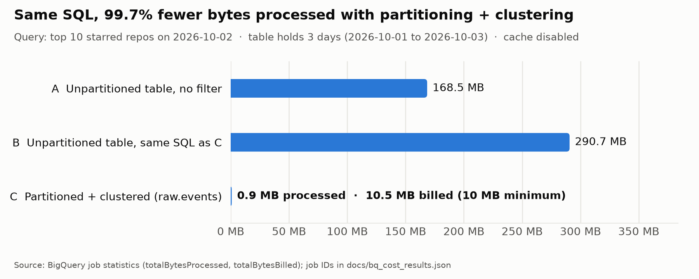

# oss-pulse

Daily analytics on open-source activity from [GH Archive](https://www.gharchive.org/).

## Problem
_TODO: what question does this answer, and for whom?_

## Architecture


```
GH Archive (hourly .json.gz)
  → ingestion/gharchive.py  → GCS (raw)
  → spark/flatten_events.py → GCS (parquet) → BigQuery (raw)
  → dbt (staging → intermediate → marts)
  → dashboard
Orchestrated by Airflow (airflow/dags/oss_pulse_daily.py); infra via Terraform.
```

## How to run
```bash
cp .env.example .env   # fill in values
make setup             # install deps
make up                # start Airflow locally
make backfill START=2026-01-01 END=2026-01-07
make test lint
make down
```

## Results


## Cost


_TODO: BigQuery bytes scanned before/after partitioning + clustering._
